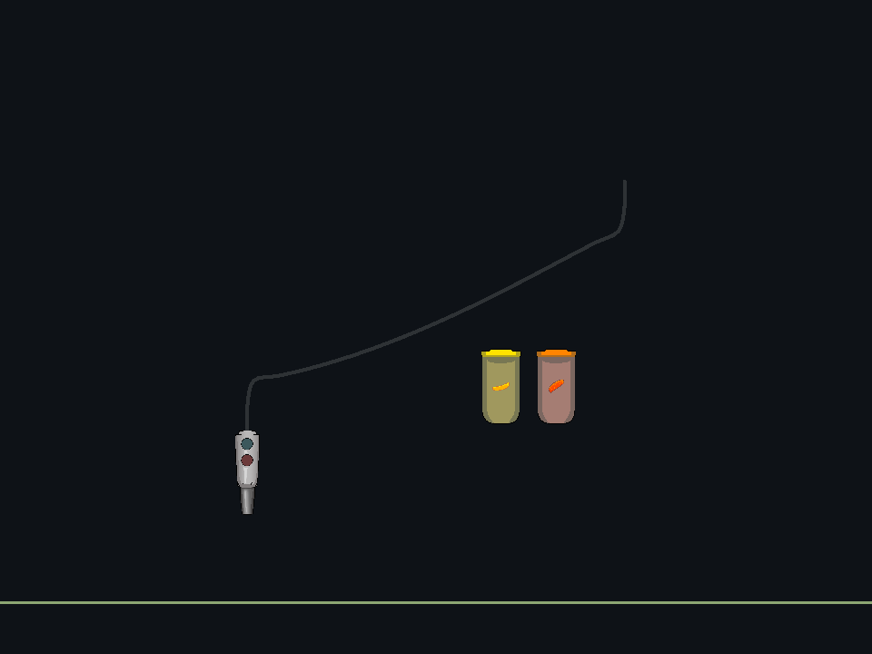
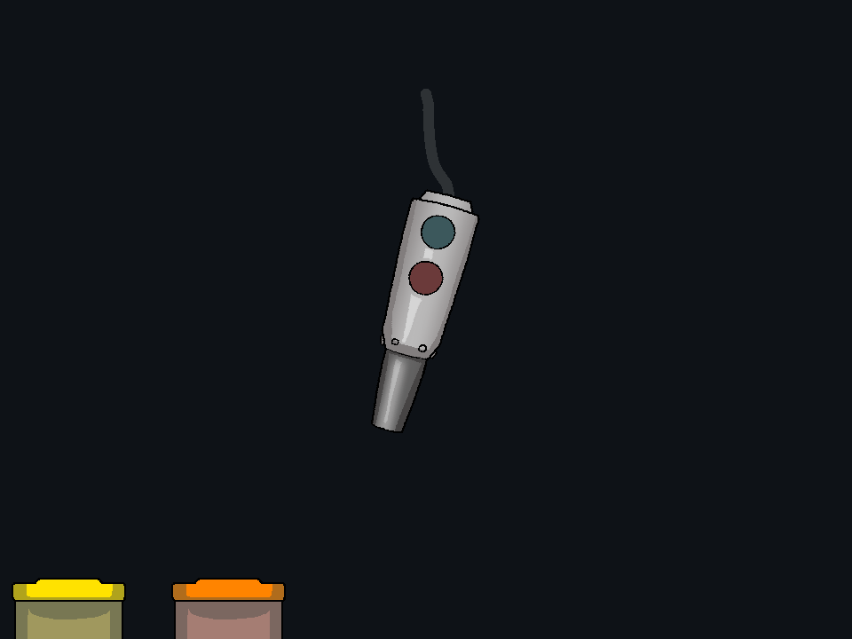

# 줄에 끌려가 매달리는 디스펜서 — 2026-10-22 (21일 착수)

**수정 및 자동 검증 완료: 8개 실행 정상 종료, PASS 4,544개, FAIL 0개.** 이전 구현은 위치를 수납점에 고정하고 각도만 흔들었다. 사용자가 요청한 것은 줄이 연결점을 당기고, 본체가 그 아래에서 위치와 자세를 함께 바꾸며 매달리는 움직임이다. 이전 위치 고정 검사는 그 요구를 검증하지 못했으므로 해당 판정 기준도 교체한다.

## 구현

- 본체 위쪽 호스 연결점에 실제 `DistanceJoint2D`를 연결한다. 반대 끝은 해당 World의 호스 고정점이다. 연결점 사이의 최대 거리만 제한하는 줄이므로, 느슨한 줄이 본체를 밀어내는 막대처럼 작동하지 않는다.
- 놓으면 본체를 Dynamic으로 바꾸고 중력·질량·관성·회전 자유도를 활성화한다. 복귀 코드는 위치와 각도를 보간하지 않고 줄 길이만 가속·감속하며 줄인다. 연결점에 걸리는 네이티브 장력이 본체를 당기고 회전시킨다.
- 줄이 다 감겨도 본체 위치·속도·각도를 초기화하지 않는다. 도착 관성, 줄 제약, 중력과 감쇠에 따라 앞뒤/좌우로 움직이는 매달림이 이어진다. `Docked`는 줄이 수납 길이에 도달했다는 상태이며, 본체가 그 프레임에 정확한 고정 좌표에 붙었다는 의미가 아니다.
- 잡는 입력 프레임에는 줄의 힘을 해제하고 수직·Kinematic으로 전환한다. 잡은 로컬 지점을 커서 아래에 유지하며 플레이어 회전은 막는다. 호스 그림의 연결은 유지된다.
- 복귀와 자유 매달림 중 외부 native/GPU 액체 충돌을 끈다. 호스 그림은 실제 연결점을 따르고, 줄에 장력이 걸리면 펴지며 느슨해지면 처진다. 이전 두께 0.115u는 유지한다.
- 사운드·기획 시트·음원·Wwise/Packages와 파편 비산 코드는 변경하지 않는다.

## 검증 방식

독립 Unity 6000.3.5f2/D3D11 사본에서 실제 Physics2D 줄 제약과 GPU 액체를 실행한다. 고정 틱 수동 재현과 실제 자동 업데이트를 구분한다. 줄 길이 감소, 실제 장력, 복귀 중 본체 회전, 감긴 뒤의 x/y 이동과 자세 변화, 장시간 감쇠, 재집기 시 수직 복원, 외부 무충돌을 확인한다. 실제 렌더 프레임과 위치/속도/장력 CSV를 남긴다.

[실행·소스·변경 범위 감사](audit.json)를 완료했다. 자동 물리 검사와 렌더 근거를 사람의 직접 조작 체감 승인으로 표현하지 않는다.

## 최종 결과

| 실행 | PASS | 종료 코드 |
| --- | ---: | ---: |
| [dispenser](../20261022-tether-verified-dispenser/exit.json) | 1954 | 0 |
| [breakage](../20261022-tether-verified-breakage/exit.json) | 231 | 0 |
| [runtime](../20261022-tether-verified-runtime/exit.json) | 29 | 0 |
| [auto-f](../20261022-tether-verified-auto-f/exit.json) | 29 | 0 |
| [auto-g](../20261022-tether-verified-auto-g/exit.json) | 29 | 0 |
| [input](../20261022-tether-verified-input/exit.json) | 1925 | 0 |
| [contents](../20261022-tether-verified-contents/exit.json) | 182 | 0 |
| [modes](../20261022-tether-verified-modes/exit.json) | 165 | 0 |

- **실제 장력과 복귀:** 수동 재현에서 줄 감김 완료까지 약 1.58초. 최대 장력 약 12.90, 복귀 중 본체 자세 변화 약 47.12°. 시작부터 끝까지 본체 위치/각도를 수납 좌표로 보간하지 않고 native joint의 최대 거리만 줄였다. 장력 수치는 게임의 2D 질량/월드 단위 기준이다.
- **줄이 다 감긴 뒤의 매달림:** 초기 3초의 본체 위치 범위는 x 약 1.314u / y 약 0.288u, 관찰된 자세 범위는 약 -15.57°~+38.17°였다. 본체가 실제로 이동하고 기울어지므로 고정 위치 회전 효과와 구분된다. 마지막 10–12초 구간의 속도는 최대 약 0.0243u/s, 평형 위치까지 거리는 최대 약 0.0129u로 감쇠했다.
- **실제 자동 업데이트:** F/G에서 World.FixedUpdate, 자동 Physics2D 및 비동기 GPU 액체 읽기를 유지한 상태로 위치 이동·자세 변화·감쇠를 확인했다. 수동 물리 호출로 대체한 결과와 별도로 실행했다.
- **집기:** 움직이는 본체의 로컬 지점을 잡으면 같은 입력 프레임에 수직/Kinematic이 되고 줄 제약을 해제한다. 커서 아래의 잡은 지점은 보존된다. 일반 회전 API와 RMB 배출 입력으로 디스펜서를 회전시키지 못하는 것을 확인했다.
- **외부 무충돌:** 초기 겹침·벽/바닥 밖·경로 전체를 덮는 장애물을 사용해 실제 native trigger와 GPU 경계/표면 가림 제외를 확인했다. 줄 제약은 외부 충돌 억제와 독립적으로 작동한다. 감긴 뒤에도 동적으로 매달리며 장애물을 밀지 않는다.
- **수명/재사용:** World 초기화, 컴포넌트 disable/enable, 모드 전환, 명시적 카메라와 독립 World, Hot/Ice 배출/재고/차단/동시 생성 한도 회귀를 통과했다. disable 때 줄을 해제하고 안전한 정지 상태로 복원하며, enable 때 재고를 채우지 않고 매달림을 재개한다.
- **기존 기능:** 입력/쉐이커, 내용물·놓기 관성, 얼음 두 모드, 파편 방향/파손의 기존 검사를 함께 통과했다. 해당 코드/에셋을 새 움직임에 맞춘다는 이유로 변경하지 않았다.

## 튜닝과 남긴 실패 기록

`20261021-tether-v1-*`와 `20261022-tether-final-*`는 중간 시도다. 매달림 자체는 재현됐으나 정지 관찰 창의 잔여 속도가 기준을 초과한 결과를 보존했다. 소스의 기본 감쇠만 바꿨을 때 같은 수치가 반복되어 미기재 프리팹 필드의 import/default 캐시 영향을 배제하지 않고, 프리팹에 설정을 명시했다. 최종 검사에서는 프리팹 값과 실제 Rigidbody의 선형 감쇠 **0.9/0.9**, 각 감쇠 **1.1/1.1** 적용을 직접 확인했다. 실패를 감추거나 정지 속도 기준을 느슨하게 바꾸지 않았다.

초기 호스 폭/여유 길이와 줄 감기 속도/가속도/중력/감쇠의 **8개 수치 필드만** Dispenser.prefab에 추가했다. 기존 프리팹 텍스트와 비교해 그 외 그림·형상·질량·버튼·참조·재고 설정이 그대로임을 감사했다. 나머지 런타임 변경은 디스펜서 partial 코드 2개와 기능 README이며, 파편 물리·사운드 기획서·Core Audio 코드·음원·Packages/Wwise는 시작 시점과 일치한다.

## 움직이는 렌더 근거

아래는 통과한 수동 Physics2D 재현에서 0.1초마다 실제 렌더한 프레임을 GIF로 묶은 것이다. 보간으로 새 동작을 만든 영상이 아니며, PNG 원본과 [실제 위치/속도/장력 CSV](../20261022-tether-verified-dispenser/suspension-trajectory.csv), [프레임 목록/해시](motion-previews.json)를 함께 남겼다. 자동 실행의 별도 타임라인은 각 auto-f/auto-g 폴더에 있다.

- [줄에 끌려 복귀하는 과정](reel-preview.gif): 16프레임, 약 1.6초.
- [호스 끝에서 매달려 출렁이는 과정](hanging-preview.gif): 60프레임, 약 6초.

이는 줄과 강체를 사용하는 게임용 근사이며 호스의 재료 역학이나 단면 변형 전체를 해석하는 모델은 아니다. 직접 플레이 체감의 최종 승인은 별도이며 사운드 청취 검사는 수행하지 않았다.
